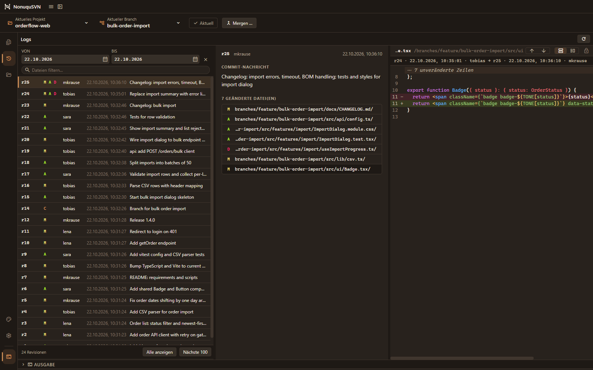

<p align="center">
  
</p>

<h1 align="center">NonuquSVN</h1>

<p align="center">
  <strong>A modern Subversion client for Windows with a Git-like feel. Because it's never too late for a new one.</strong>
</p>

<p align="center">
  
  
  
</p>

## Why "Nonuqu"?

From the Latin *nonnumquam*, literally "not never", which means "sometimes". Shortened to **nonuqu**, it follows the motto *never say never*.

Subversion may be quieter than Git these days, but it is still going strong in many teams, and it deserves a client that feels good to use.

## Git-like, on top of Subversion

Subversion is solid, but its tooling often feels dated. NonuquSVN brings the workflow people know from Git clients to SVN:

- **Review before you commit:** inspect every change in a diff, then commit from the same view
- **Branches as a first-class thing:** switch between branches and merge them with a guided workflow instead of the command line

Your repository stays plain Subversion.

<p align="center">
  <a href="assets/log-diff-dark-coffee.png">
    
  </a>
  <br>
  <sub>Log view with changed files and diff (Dark Coffee theme). Click to enlarge.</sub>
</p>

## Features

- **Changes:** review local changes with side-by-side diffs and commit right away
- **History:** browse the log and blame per project or file
- **Branches:** create, switch, and merge without leaving the app
- **Compare:** diff revisions and paths
- **Projects:** keep all your projects and working copies in one place
- **Explorer integration:** right-click menu for working copies (installer only)
- **Bilingual:** German and English UI

## Install

1. Download the latest `NonuquSVN-Setup-x.y.z.exe` from [Releases](../../releases).
2. Run it.

> [!NOTE]
> The installer is not code-signed yet, so Windows SmartScreen may warn on first launch.
> Choose **More info → Run anyway**.

**You'll need:** Windows 10 or 11 (x64) and the Subversion command line client (`svn`) on your `PATH`.

## Development

Requires [Node.js](https://nodejs.org/) 22 and the `svn` command line client.

```powershell
npm install
npm run dev
```

| Command | What it does |
| --- | --- |
| `npm run dev` | Run the app in development |
| `npm run check` | Lint and format check (Biome) |
| `npm run build` | Build the application |
| `npm run dist` | Build the installer into `release/` |

`npm run dist` also builds the native Explorer extension, which needs Visual Studio Build Tools
(Desktop development with C++) and PowerShell. See
`build-resources/shell-extension`.

## License

MIT. See [LICENSE](LICENSE).
